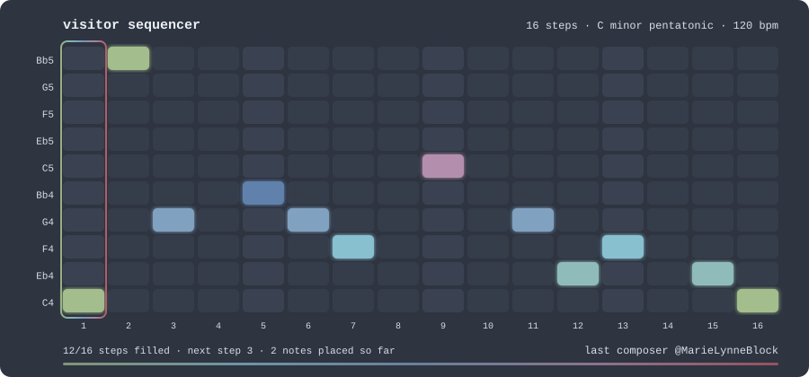

<a href="https://themunchkinalgorithm.world">
  <picture>
    <source media="(prefers-color-scheme: dark)" srcset="https://raw.githubusercontent.com/MarieLynneBlock/MarieLynneBlock/master/assets/header/waveform-dark.svg">
    <source media="(prefers-color-scheme: light)" srcset="https://raw.githubusercontent.com/MarieLynneBlock/MarieLynneBlock/master/assets/header/waveform-light.svg">
    
  </picture>
</a>

  
    ↑ The header is not a picture. It is the waveform of the loop <em>you</em> can edit further down; redrawn every time someone adds a note to the sequencer.
  

  <a href="https://themunchkinalgorithm.world">🪼 themunchkinalgorithm.world</a> ·
  <a href="https://www.linkedin.com/in/marielynneblock/">💼 LinkedIn</a> ·
  <a href="https://huggingface.co/MarieLynneBlock">🤗 Hugging Face</a> ·
  <a href="https://bandcamp.com/marielynneblock">🎧 Bandcamp</a>
    
  

## Hej! I'm Marie-Lynne 

AI expert & data scientist by day, creative coder and sound designer by heart. I work where logic meets
creativity — training models to think and teaching people to dream — and I believe the best algorithms have
a heartbeat. This page is built on one rule borrowed from [my website](https://themunchkinalgorithm.world):
**no static pixels**. Everything you see is generated by code in this repository, and most of it you can change.

---

## 🌿 The garden

A community **L-system**. Every visitor can nudge it: add an iteration, mutate a rewrite rule, or turn the season.
Each button opens a pre-filled issue; a workflow applies your change, redraws the plant, credits you and closes the issue.
If nobody visits, a nightly *drift* keeps it slowly evolving.

  <picture>
    <source media="(prefers-color-scheme: dark)" srcset="https://raw.githubusercontent.com/MarieLynneBlock/MarieLynneBlock/master/assets/garden/garden-dark.svg">
    <source media="(prefers-color-scheme: light)" srcset="https://raw.githubusercontent.com/MarieLynneBlock/MarieLynneBlock/master/assets/garden/garden-light.svg">
    
  </picture>

<table align="center">
  <tr>
    <td align="center"><a href="https://github.com/MarieLynneBlock/MarieLynneBlock/issues/new?title=garden%3A%20grow&body=Just%20press%20%2A%2ASubmit%20new%20issue%2A%2A%20%E2%80%94%20a%20workflow%20will%20apply%20this%20to%20the%20garden%2C%20re-render%20it%20and%20close%20this%20issue%20with%20a%20thank-you.%20%F0%9F%8C%BF"><strong>🌱 grow</strong></a> one more iteration</td>
    <td align="center"><a href="https://github.com/MarieLynneBlock/MarieLynneBlock/issues/new?title=garden%3A%20mutate&body=Just%20press%20%2A%2ASubmit%20new%20issue%2A%2A%20%E2%80%94%20a%20workflow%20will%20apply%20this%20to%20the%20garden%2C%20re-render%20it%20and%20close%20this%20issue%20with%20a%20thank-you.%20%F0%9F%8C%BF"><strong>🧬 mutate</strong></a> tweak a rule or angle</td>
    <td align="center"><a href="https://github.com/MarieLynneBlock/MarieLynneBlock/issues/new?title=garden%3A%20season&body=Just%20press%20%2A%2ASubmit%20new%20issue%2A%2A%20%E2%80%94%20a%20workflow%20will%20apply%20this%20to%20the%20garden%2C%20re-render%20it%20and%20close%20this%20issue%20with%20a%20thank-you.%20%F0%9F%8C%BF"><strong>🍂 season</strong></a> cycle the palette</td>
  </tr>
</table>

<!-- GARDEN:CREDITS:START -->
<strong>Fractal Plant</strong> · generation 1 · autumn · 3 interventions recent gardeners: <a href="https://github.com/MarieLynneBlock">@MarieLynneBlock</a> latest: @MarieLynneBlock turned the season to autumn
<!-- GARDEN:CREDITS:END -->

  
how does this work?

   

  An L-system is a tiny grammar: start from an axiom (`X`), apply rewrite rules (`X → F+[[X]-X]-F[-FX]+X`, `F → FF`)
  a few times, then let a turtle draw the result — `F` steps forward, `+`/`-` turn, `[`/`]` push and pop a branch.
  Lindenmayer invented them in 1968 to describe algae; they also happen to make lovely plants and, if you map the
  same symbols to pitches, lovely music. The current rules are printed under the plant.
  When the plant reaches six iterations the next *grow* reseeds a new species and bumps the generation.
  Source: [`generators/garden/lsystem.py`](generators/garden/lsystem.py).

---

## 🎛️ The sequencer

Sixteen steps, **C minor pentatonic** over two octaves, 120 BPM. Pick a note and it lands on the next free step
(then wraps around and overwrites). A workflow re-renders the piano roll, synthesises a **WAV** and a **MIDI** file,
and redraws the header from the new audio.

  <picture>
    <source media="(prefers-color-scheme: dark)" srcset="https://raw.githubusercontent.com/MarieLynneBlock/MarieLynneBlock/master/assets/sequencer/sequencer-dark.svg">
    <source media="(prefers-color-scheme: light)" srcset="https://raw.githubusercontent.com/MarieLynneBlock/MarieLynneBlock/master/assets/sequencer/sequencer-light.svg">
    
  </picture>

<table align="center">
  <tr>
    <td align="center"><a href="https://github.com/MarieLynneBlock/MarieLynneBlock/issues/new?title=sequencer%3A%20C4&body=Just%20press%20%2A%2ASubmit%20new%20issue%2A%2A%20%E2%80%94%20a%20workflow%20will%20add%20this%20note%20to%20the%20sequencer%2C%20re-render%20the%20piano%20roll%2C%20WAV%2C%20MIDI%20and%20header%2C%20then%20close%20this%20issue.%20%F0%9F%8E%9B%EF%B8%8F"><strong>♪ C4</strong></a></td>
    <td align="center"><a href="https://github.com/MarieLynneBlock/MarieLynneBlock/issues/new?title=sequencer%3A%20Eb4&body=Just%20press%20%2A%2ASubmit%20new%20issue%2A%2A%20%E2%80%94%20a%20workflow%20will%20add%20this%20note%20to%20the%20sequencer%2C%20re-render%20the%20piano%20roll%2C%20WAV%2C%20MIDI%20and%20header%2C%20then%20close%20this%20issue.%20%F0%9F%8E%9B%EF%B8%8F"><strong>♪ E♭4</strong></a></td>
    <td align="center"><a href="https://github.com/MarieLynneBlock/MarieLynneBlock/issues/new?title=sequencer%3A%20F4&body=Just%20press%20%2A%2ASubmit%20new%20issue%2A%2A%20%E2%80%94%20a%20workflow%20will%20add%20this%20note%20to%20the%20sequencer%2C%20re-render%20the%20piano%20roll%2C%20WAV%2C%20MIDI%20and%20header%2C%20then%20close%20this%20issue.%20%F0%9F%8E%9B%EF%B8%8F"><strong>♪ F4</strong></a></td>
    <td align="center"><a href="https://github.com/MarieLynneBlock/MarieLynneBlock/issues/new?title=sequencer%3A%20G4&body=Just%20press%20%2A%2ASubmit%20new%20issue%2A%2A%20%E2%80%94%20a%20workflow%20will%20add%20this%20note%20to%20the%20sequencer%2C%20re-render%20the%20piano%20roll%2C%20WAV%2C%20MIDI%20and%20header%2C%20then%20close%20this%20issue.%20%F0%9F%8E%9B%EF%B8%8F"><strong>♪ G4</strong></a></td>
    <td align="center"><a href="https://github.com/MarieLynneBlock/MarieLynneBlock/issues/new?title=sequencer%3A%20Bb4&body=Just%20press%20%2A%2ASubmit%20new%20issue%2A%2A%20%E2%80%94%20a%20workflow%20will%20add%20this%20note%20to%20the%20sequencer%2C%20re-render%20the%20piano%20roll%2C%20WAV%2C%20MIDI%20and%20header%2C%20then%20close%20this%20issue.%20%F0%9F%8E%9B%EF%B8%8F"><strong>♪ B♭4</strong></a></td>
    <td align="center"><a href="https://github.com/MarieLynneBlock/MarieLynneBlock/issues/new?title=sequencer%3A%20rest&body=Just%20press%20%2A%2ASubmit%20new%20issue%2A%2A%20%E2%80%94%20a%20workflow%20will%20add%20this%20note%20to%20the%20sequencer%2C%20re-render%20the%20piano%20roll%2C%20WAV%2C%20MIDI%20and%20header%2C%20then%20close%20this%20issue.%20%F0%9F%8E%9B%EF%B8%8F"><strong>𝄽 rest</strong></a></td>
  </tr>
  <tr>
    <td align="center"><a href="https://github.com/MarieLynneBlock/MarieLynneBlock/issues/new?title=sequencer%3A%20C5&body=Just%20press%20%2A%2ASubmit%20new%20issue%2A%2A%20%E2%80%94%20a%20workflow%20will%20add%20this%20note%20to%20the%20sequencer%2C%20re-render%20the%20piano%20roll%2C%20WAV%2C%20MIDI%20and%20header%2C%20then%20close%20this%20issue.%20%F0%9F%8E%9B%EF%B8%8F"><strong>♪ C5</strong></a></td>
    <td align="center"><a href="https://github.com/MarieLynneBlock/MarieLynneBlock/issues/new?title=sequencer%3A%20Eb5&body=Just%20press%20%2A%2ASubmit%20new%20issue%2A%2A%20%E2%80%94%20a%20workflow%20will%20add%20this%20note%20to%20the%20sequencer%2C%20re-render%20the%20piano%20roll%2C%20WAV%2C%20MIDI%20and%20header%2C%20then%20close%20this%20issue.%20%F0%9F%8E%9B%EF%B8%8F"><strong>♪ E♭5</strong></a></td>
    <td align="center"><a href="https://github.com/MarieLynneBlock/MarieLynneBlock/issues/new?title=sequencer%3A%20F5&body=Just%20press%20%2A%2ASubmit%20new%20issue%2A%2A%20%E2%80%94%20a%20workflow%20will%20add%20this%20note%20to%20the%20sequencer%2C%20re-render%20the%20piano%20roll%2C%20WAV%2C%20MIDI%20and%20header%2C%20then%20close%20this%20issue.%20%F0%9F%8E%9B%EF%B8%8F"><strong>♪ F5</strong></a></td>
    <td align="center"><a href="https://github.com/MarieLynneBlock/MarieLynneBlock/issues/new?title=sequencer%3A%20G5&body=Just%20press%20%2A%2ASubmit%20new%20issue%2A%2A%20%E2%80%94%20a%20workflow%20will%20add%20this%20note%20to%20the%20sequencer%2C%20re-render%20the%20piano%20roll%2C%20WAV%2C%20MIDI%20and%20header%2C%20then%20close%20this%20issue.%20%F0%9F%8E%9B%EF%B8%8F"><strong>♪ G5</strong></a></td>
    <td align="center"><a href="https://github.com/MarieLynneBlock/MarieLynneBlock/issues/new?title=sequencer%3A%20Bb5&body=Just%20press%20%2A%2ASubmit%20new%20issue%2A%2A%20%E2%80%94%20a%20workflow%20will%20add%20this%20note%20to%20the%20sequencer%2C%20re-render%20the%20piano%20roll%2C%20WAV%2C%20MIDI%20and%20header%2C%20then%20close%20this%20issue.%20%F0%9F%8E%9B%EF%B8%8F"><strong>♪ B♭5</strong></a></td>
    <td align="center"><a href="https://github.com/MarieLynneBlock/MarieLynneBlock/blob/master/assets/sequencer/sequence.wav"><strong>▶ listen</strong></a> · <a href="https://github.com/MarieLynneBlock/MarieLynneBlock/raw/master/assets/sequencer/sequence.mid"><strong>⬇ MIDI</strong></a></td>
  </tr>
</table>

<!-- SEQUENCER:CREDITS:START -->
<strong>12/16 steps filled</strong> · next free step: 2 · 1 notes placed by visitors recent composers: <a href="https://github.com/MarieLynneBlock">@MarieLynneBlock</a> latest: @MarieLynneBlock placed C4 on step 1
<!-- SEQUENCER:CREDITS:END -->

  
why does it always sound fine?

   

  Pentatonic scales have no semitone clashes, so any combination of these ten pitches is consonant —
  it is the same trick behind the black keys on a piano and most crowd-sourced music toys. The audio is
  synthesised with NumPy (a sine with two harmonics, an exponential envelope and a dotted-eighth delay),
  written with the standard-library `wave` module, and the MIDI file is hand-rolled bytes. No audio libraries, no services.
  Source: [`generators/sequencer/sequencer.py`](generators/sequencer/sequencer.py) ·
  header: [`generators/waveform/waveform.py`](generators/waveform/waveform.py).

---

## 🧰 Toolbox

  <picture>
    <source media="(prefers-color-scheme: dark)" srcset="https://raw.githubusercontent.com/MarieLynneBlock/MarieLynneBlock/master/assets/toolbox/toolbox-dark.svg">
    <source media="(prefers-color-scheme: light)" srcset="https://raw.githubusercontent.com/MarieLynneBlock/MarieLynneBlock/master/assets/toolbox/toolbox-light.svg">
    
  </picture>

one SVG, generated from <a href="generators/toolbox/toolbox.yaml">a YAML file</a> — not two hundred badge requests.

---

## 👩‍💻 Meet the maker

  🔬 <em>Science</em> · 💡 <em>Technology</em> · 🏗 <em>Engineering</em> · 🎨 <em>Art</em> · 📈 <em>Maths</em> 
  a happy advocate of the full STEAM 💨

**Professionally** — I'm an AI expert and data scientist at [CM/MC](https://www.linkedin.com/company/cm-mc), with almost
a decade of turning messy data into decisions, products and (ethical, interpretable) models. I hold a **BSc (Hons) Creative
Computing** from the University of London (magna cum laude), an **MBA in Health**, and I did Berklee's *AI for Music & Audio*
summer programme because I could not help myself. Healthcare, NLP/OCR and human–machine interaction are the problems that keep me up at night — in a good way.

**Creatively** — my programming started in sound engineering and sound design, and it never left: MIR, DSP, generative music,
L-systems that draw *and* play, live algorithms on stage. I research with the [Sound of AI](https://www.linkedin.com/company/the-sound-of-ai/) community,
shoot photos and music videos on mirrorless cameras, and run [The Munchkin Algorithm](https://themunchkinalgorithm.world) — a studio
for intelligent systems, creative code, sound and workshops.

**As a human** — I coach at [Django Girls](https://djangogirls.org) (since 2018), beta-test courses for Coursera, speak several
languages and collect more, read everything, and split my time between Belgium and Sweden with a junior programmer who commandeers
my keyboard and two feline QA engineers who sleep on it.

  
a few more things

   

  - **Theme purist** — I cannot look at an unstyled Matplotlib plot. Nord on everything (yes, this page too).
  - **Live coding** — I would love to perform live-coded music more often. Encouragement and tips from fellow algoravers welcome.
  - **Teaching** — I learn fastest when I have to explain it; workshops are my favourite excuse.
  - **Most of the code here is me monkeying around 🐒** — experiments, courses, hobby projects. A glimpse into my exploration 🧪, not a testament to my day job 🦸.

---

## 📓 Noteworthy

  
<strong>Creative computing, sound & generative art</strong> (click to expand)

   

  - 🧪 [**sonic-alchemy-lab**](https://github.com/MarieLynneBlock/sonic-alchemy-lab) — Jupyter notebooks for sound analysis: waveforms, spectra, Fourier, MIR features.
  - 🎼 [**Harmony in Algorithmic Beauty**](https://github.com/MarieLynneBlock/MarieLynneBlock.github.io) — bachelor thesis: L-systems driving simultaneous visual and musical generation.
  - 🥁 [**digital-sound-playground**](https://github.com/MarieLynneBlock/digital-sound-playground) — algorithmic patterns that generate music samples.
  - 🪼 [**TheMunchkinAlgorithm_website**](https://github.com/MarieLynneBlock/TheMunchkinAlgorithm_website) — my website, made of separately programmed pixels (p5.js).
  - 🌊 [**animated-banner_github**](https://github.com/MarieLynneBlock/animated-banner_github) — the previous animated banner of this very README.
  - 🎹 [**RealTimeAudioSignalProcessing-Faust**](https://github.com/MarieLynneBlock/RealTimeAudioSignalProcessing-Faust) — functional DSP in Faust.

  
<strong>AI, data & agents</strong> (click to expand)

   

  - 🧙🏻‍♀️ [**arcanum-artifex**](https://github.com/MarieLynneBlock/arcanum-artifex) — prompts, skills and agents that survive contact with real workflows. No vendor loyalty. Occasionally heretical.
  - 📖 [**claude-lab**](https://github.com/MarieLynneBlock/claude-lab) — everything I actually know about Claude Code; tested, verified, opinionated.
  - 🔍 [**LearnLab_OCR**](https://github.com/MarieLynneBlock/LearnLab_OCR) — material to teach basic OCR concepts.
  - 🏥 [**AI-in-healthcare_KULeuvenX**](https://github.com/MarieLynneBlock/AI-in-healthcare_KULeuvenX) · 🧠 [**nanodegree_generative-AI**](https://github.com/MarieLynneBlock/nanodegree_generative-AI) · 📦 [**nanodegree_AI-product-management**](https://github.com/MarieLynneBlock/nanodegree_AI-product-management)

  
<strong>Studies</strong> (click to expand)

   

  - 🎓 **BSc (Hons) Creative Computing** — University of London · magna cum laude (GPA 3.9)
  - 🎓 **MBA, Healthcare Management**
  - 🎓 **AI for Music & Audio** — Berklee College of Music summer programme · summa cum laude (GPA 4.0)
  - 🎓 **Music Information Retrieval** — [UVic professional programme](https://github.com/MarieLynneBlock/music-information-retrieval_UVAC)
  - 🎓 **Generative Art & Computational Creativity** — [SFU professional programme](https://github.com/MarieLynneBlock/generative-art-and-computational-creativity_SFU)

  
<strong>Open source & community</strong> (click to expand)

   

  - 🍪 [**api-bakery**](https://github.com/ByteBuddies-HQ/api-bakery) — a Cookiecutter template for well-behaved APIs.
  - 🎧 [**Sound of AI**](https://www.linkedin.com/company/the-sound-of-ai/) — research collaborator since 2021 (NSynth dataset work, open-source audio ML).
  - 👩‍💻 [**Django Girls**](https://djangogirls.org) — code coach and guest speaker since 2018.

---

## 📈 Metrics

  
show stats (click to expand)

   

  

    
     
    
  

  
rendered daily by <a href="https://github.com/lowlighter/metrics">lowlighter/metrics</a> running in this repo's Actions — self-hosted, so it does not vanish when a free service does.

---

## 🖇️ Let's connect

I'm always up for learning something new, collaborating on odd projects or talking shop about sound, AI and everything in between.

  <a href="https://themunchkinalgorithm.world">🪼 Website</a> ·
  <a href="https://www.linkedin.com/in/marielynneblock/">💼 LinkedIn</a> ·
  <a href="https://huggingface.co/MarieLynneBlock">🤗 Hugging Face</a> ·
  <a href="https://bandcamp.com/marielynneblock">🎧 Bandcamp</a> ·
  <a href="https://steamcommunity.com/id/KaptajnNord">🎮 Steam</a>

---

  
🔧 how this page is built

   

  | piece | source | trigger |
  |---|---|---|
  | header waveform | [`generators/waveform/waveform.py`](generators/waveform/waveform.py) | whenever the sequencer changes |
  | L-system garden | [`generators/garden/lsystem.py`](generators/garden/lsystem.py) | visitor issues · nightly drift |
  | step-sequencer (SVG, WAV, MIDI) | [`generators/sequencer/sequencer.py`](generators/sequencer/sequencer.py) | visitor issues |
  | toolbox | [`generators/toolbox/toolbox.py`](generators/toolbox/toolbox.py) | on push to its config |
  | metrics | [lowlighter/metrics](https://github.com/lowlighter/metrics) | daily |
  | glue | [`generators/playground.py`](generators/playground.py) · [`.github/workflows/`](.github/workflows) | — |

  Every SVG exists in a dark and a light variant, picked with `<picture>` and `prefers-color-scheme`.
  Fork it, change `toolbox.yaml` and the two `state.json` files, and you have your own living README.

Created with 🫀 and 🧠 by Marie-Lynne Block · ©2026 · nothing on this page is a static image

